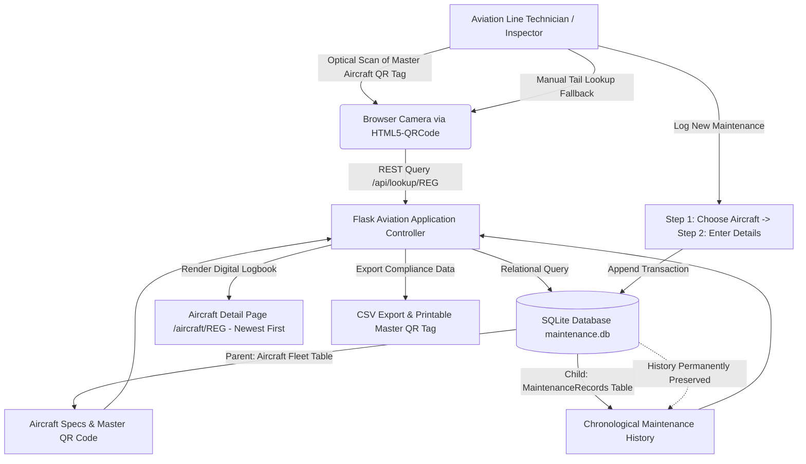

# Aircraft Maintenance Scanner – Digital Maintenance Record System
### Fleet Aircraft QR Identification and Digital Maintenance Tracking System

> **Academic Coursework Notice:** This project is prepared for the **Bachelor of Business Administration (BBA) in Aviation Management / Aviation Operations**. All fleet aircraft records, serial numbers, and maintenance entries represent educational demonstration data designed to illustrate airline MRO (Maintenance, Repair, and Overhaul) digital transformation.

---

## 1. Executive Summary & Project Abstract

In commercial aviation management, flight safety, operational efficiency, and strict regulatory compliance form the cornerstone of profitable airline operations. Every commercial airliner represents a multi-million-dollar asset requiring rigorous airframe inspections and continuous airworthiness tracking.

The **Aircraft Maintenance Scanner – Digital Maintenance Record System** provides an operational prototype that bridges physical aircraft airframes with digitized, tamper-evident maintenance tracking. 

- **Aircraft-Exclusive QR Codes:** Master QR codes are generated exclusively for aircraft airframes (featuring Air India / AeroFleet `VT-AER`).
- **Instant Optical Access:** Scanning an aircraft's Master QR code immediately retrieves its complete chronological maintenance logs, airworthiness status, and previous service history.
- **Persistent Maintenance Recording:** Adding new maintenance logs or updating inspections dynamically appends to the aircraft's records in SQLite and permanently preserves all historical entries.
- **Two-Step Maintenance Flow:** When entering new maintenance work, the system verifies the aircraft registration and presents the technical maintenance details for that specific aircraft.
- **Compact & Centralized Architecture:** Redundant scattered buttons have been consolidated into one intuitive, organized Action Hub.

---

## 2. Active Aircraft Registry

| Airline / Operator | Aircraft Model | Tail Registration | Base Airport | Engines | Subsystem Logs |
|---|---|---|---|---|---|
| **Air India / AeroFleet** | Airbus A320neo | `VT-AER` | Chennai (MAA) / Bengaluru (BLR) | 2x CFM LEAP-1A26 | 10 Logs |

---

## 3. System Architecture & Aviation Operational Flow



---

## 5. Demonstration Rotables & Baseline Maintenance Records

The prototype is initialized with 5 critical commercial aircraft rotables and realistic maintenance logs:

| Component ID | Component Name | Operational System | Service Date | Initial Maintenance Activity | Fault Reported | Action Taken | Technician | Status | Next Inspection |
|---|---|---|---|---|---|---|---|---|---|
| **ENG-001** | Aircraft Engine | Powerplant / Propulsion | 10 Oct 2026 | Engine condition inspection | Unusual vibration reported | Vibration checked; further inspection recommended | Technician A | Further inspection required | 10 Nov 2026 |
| **LG-002** | Landing Gear | Undercarriage & Retraction | 05 Oct 2026 | Landing gear visual inspection | Hydraulic fluid leakage suspected | Leakage assessment recommended | Technician B | Pending inspection | 05 Nov 2026 |
| **TYR-003** | Aircraft Tyre | Wheels, Brakes & Tyres | 08 Oct 2026 | Tyre condition and pressure check | Low tyre pressure | Pressure corrected as a sample action | Technician C | Completed — sample record | 08 Nov 2026 |
| **BRK-004** | Aircraft Brake System | Deceleration & Antiskid | 12 Oct 2026 | Brake system inspection | Brake wear suspected | Detailed brake inspection recommended | Technician A | Further inspection required | 12 Nov 2026 |
| **BAT-005** | Aircraft Battery | Emergency & Electrical Power | 15 Oct 2026 | Battery condition check | Battery voltage below expected level | Battery test and charging-system check recommended | Technician B | Pending inspection | 15 Nov 2026 |

---

## 6. Technology Stack

- **Backend:** Python 3.10+ & Flask 3.x (Clean, modular, and beginner-friendly web application framework)
- **Database:** SQLite3 with relational foreign keys enabled (`PRAGMA foreign_keys = ON;`)
- **QR Generation:** Python `qrcode` and `Pillow` libraries (generates stable, high-contrast 2D barcodes)
- **Optical Scanner:** `html5-qrcode` JavaScript library (browser-based camera scanning on localhost/HTTPS)
- **Frontend Design:** HTML5, CSS3, Vanilla JavaScript, Lucide SVG Icons (Aviation Navy Blue, Sky Blue, and Clean White palette)
- **Testing:** `pytest` (automated validation suite)

---

## 7. Windows PowerShell Setup & Execution Guide

Open **PowerShell** in the project folder `c:\Users\Lenovo\OneDrive\Desktop\aircraft`:

### Step 1: Activate Virtual Environment
```powershell
.\venv\Scripts\Activate.ps1
```
*(If PowerShell displays a script policy warning, run: `Set-ExecutionPolicy -ExecutionPolicy RemoteSigned -Scope Process`)*

### Step 2: Install Required Dependencies
```powershell
pip install -r requirements.txt
```

### Step 3: Run the Automated Testing Suite
```powershell
python -m pytest -v tests/test_app.py
```
*Expected result: `9 passed in ~0.95s`*

### Step 4: Launch Application Server
```powershell
python app.py
```

### Step 5: Open Application
Navigate in Google Chrome or Microsoft Edge to:
👉 **[http://127.0.0.1:5000](http://127.0.0.1:5000)**

---

## 8. Automated Test Summary Table

| Test Case | Function | Aviation Operational Capability Verified | Test Result |
|---|---|---|:---:|
| **TC-01** | `test_dashboard_loads` | Fleet operations dashboard loads metrics and active fleet components | **PASSED** |
| **TC-02** | `test_component_list_and_search` | Fleet component inventory renders and search filters by ID or Name | **PASSED** |
| **TC-03** | `test_component_registration_and_qr_generation` | New rotable registration automatically generates stable QR code PNG | **PASSED** |
| **TC-04** | `test_duplicate_component_id_rejected` | Prevents duplicate component IDs to protect fleet inventory integrity | **PASSED** |
| **TC-05** | `test_component_history_view_and_unknown_id` | Historical log rendering and HTTP 404 for invalid part numbers | **PASSED** |
| **TC-06** | `test_api_lookup_endpoint` | JSON lookup API consumed by optical camera scanner and mobile devices | **PASSED** |
| **TC-07** | `test_add_maintenance_record_and_preserve_history` | **Appending maintenance preserves all historical logs; QR unchanged** | **PASSED** |
| **TC-08** | `test_invalid_date_rejected` | Enforces ISO standard date format (`YYYY-MM-DD`) for maintenance records | **PASSED** |
| **TC-09** | `test_all_records_and_csv_export` | Fleet maintenance audit logs view and spreadsheet-ready CSV export | **PASSED** |

---

## 9. Evaluator Demonstration Walkthrough (For BBA Aviation Presentation)

Follow this structured script during your college evaluation or project review:

### Step 1: Explain the Aviation Business Problem
- *"Good morning, respected evaluators. In airline fleet management, an Aircraft On Ground (AOG) due to unverified maintenance can cost over $50,000 per hour. Paper technical logs are slow and vulnerable to error. Our project, **Aircraft Maintenance Scanner**, provides a digitized maintenance tracking system using optical QR codes to minimize turnaround times and ensure 100% audit readiness."*

### Step 2: Showcase the Fleet Dashboard (`/`)
- Open `http://127.0.0.1:5000`.
- Show the 5 key registered components (`ENG-001` through `BAT-005`).
- Highlight the operational counters: Total Components, Total Maintenance Logs, Pending Inspections, and Completed Records.
- Show the **Recent Maintenance Activity Across Fleet** feed.

### Step 3: Demonstrate Search & Traceability (`/components`)
- Click **Registered Components**.
- In the search bar, type `"Tyre"` to immediately locate `TYR-003`. Click **Reset**.
- Explain how this provides instant asset traceability for airline stores and line maintenance hangars.

### Step 4: Demonstrate Optical QR Scanning & Manual Fallback (`/scan`)
- Click **Scan QR Code**.
- Explain: *"This scanner uses HTML5 camera streaming to decode component QR codes in real-time. For desktop evaluations without a camera, we provide a manual ID lookup fallback."*
- Click the quick-test button for **`ENG-001 (Aircraft Engine)`** (or type `ENG-001`).
- The system immediately verifies the component via the backend JSON API and redirects to `http://127.0.0.1:5000/component/ENG-001`.

### Step 5: Highlight QR Code Stability & Printable Service Tags
- On `ENG-001`, show the QR code image.
- Click **Download QR** to save the label.
- Click **Print Service Tag** to demonstrate the physical aviation service tag attached to aircraft parts.
- Point out the initial maintenance record (`Unusual vibration reported`, status `Further inspection required`).

### Step 6: Add Maintenance Record & Prove History Preservation (`/maintenance/new`)
- Click **Add New Maintenance Record**.
- Fill in:
  - Maintenance Activity: `Turbine boroscopic inspection and vibration analysis`
  - Fault: `Minor telemetry vibration anomaly`
  - Action Taken: `Boroscopic inspection completed; blades within tolerance`
  - Technician: `Technician A`
  - Service Status: `Completed — sample record`
  - Next Inspection Date: `2026-12-10`
- Click **Save Maintenance Record**.
- **Key point for evaluators:** Show that the new record is displayed at the top, the previous record remains preserved below it, the log count updates from 1 to 2, and the QR code remains permanent.

### Step 7: Demonstrate Regulatory Audit Export (`/records`)
- Click **All Maintenance Logs**.
- Click **Export CSV** to download the complete maintenance history file, demonstrating compatibility with airline enterprise systems (e.g. SAP, AMOS, or Boeing/Airbus MRO software).

---

## 10. BBA Aviation Viva Voce Questions & Answers

### Q1: What is the significance of this project in Aviation Management?
**Answer:** This project addresses airline operational efficiency and airworthiness compliance. By replacing paper logs with QR-based digital identification, airlines reduce ground turnaround times (TAT), prevent costly Aircraft On Ground (AOG) delays, eliminate manual transcription errors, and ensure audit-ready maintenance logs conforming to international aviation standards (DGCA, FAA, EASA).

### Q2: What is an Aircraft On Ground (AOG) and how does this system mitigate it?
**Answer:** AOG refers to an aircraft that cannot fly due to a technical defect or scheduled maintenance check. AOG costs commercial airlines $10,000 to over $150,000 per hour in passenger compensation, flight cancellations, and airport gate fees. Our scanner enables rapid component status verification on the tarmac, helping maintenance controllers clear or ground aircraft quickly and accurately.

### Q3: How does this system support CAMO (Continuing Airworthiness Management Organisation)?
**Answer:** Under aviation regulations (like DGCA CAR M / EASA Part-M), an airline's CAMO department must maintain complete, unbroken maintenance records for every rotable component throughout its operational life. Our system stores all maintenance logs chronologically in an ACID-compliant database, ensuring that no historical records are overwritten, and provides instant CSV exports for airworthiness reviews.

### Q4: Why are QR codes used instead of RFID in this prototype?
**Answer:** While RFID tags are effective, they require specialized, expensive handheld RFID readers ($1,000–$3,000 each). QR codes can be scanned using existing smartphones, tablets, or ruggedized laptops already carried by tarmac maintenance personnel, drastically lowering capital expenditure (CAPEX) for airlines while maintaining high scanning speed and durability.

### Q5: Why doesn't the component QR code change when new maintenance is logged?
**Answer:** The QR code encodes only the permanent component identifier (`ENG-001`), not dynamic service status. The status is queried dynamically from SQLite in real-time. This ensures that physical QR service tags affixed to engines, landing gear, or avionics do not need to be reprinted or replaced every time routine maintenance is performed.

### Q6: What civil aviation regulations govern aircraft maintenance record-keeping?
**Answer:**
- **DGCA (India):** Civil Aviation Requirements (CAR) Section 2 (Airworthiness) and CAR M (Continuing Airworthiness).
- **FAA (USA):** 14 CFR Part 43 (Maintenance, Preventive Maintenance, and Alterations) and Part 91.417 (Maintenance Records).
- **EASA (Europe):** Part-M (Continuing Airworthiness) and Part-145 (Approved Maintenance Organisations).

---

## 11. Limitations & Future Aviation Enhancements

### Current Prototype Scope:
- Focused on demonstration rotable tracking and logbook digitization.
- Single-user access without biometric technician license authentication.

### Future Commercial Enhancements:
- **ERP Integration:** Direct API integration with commercial airline software such as **AMOS**, **TRAX**, or **SAP Aviation**.
- **Digital Signatures:** Cryptographic digital signatures conforming to DGCA and FAA Part 120 e-signature guidelines.
- **Predictive Maintenance (AI/ML):** Integrating flight telematics and engine health monitoring (EHM) sensor data to predict component failure prior to scheduled inspection dates.

---
*Aircraft Maintenance Scanner – Digital Maintenance Record System &bull; BBA in Aviation Management Academic Project 2026*
